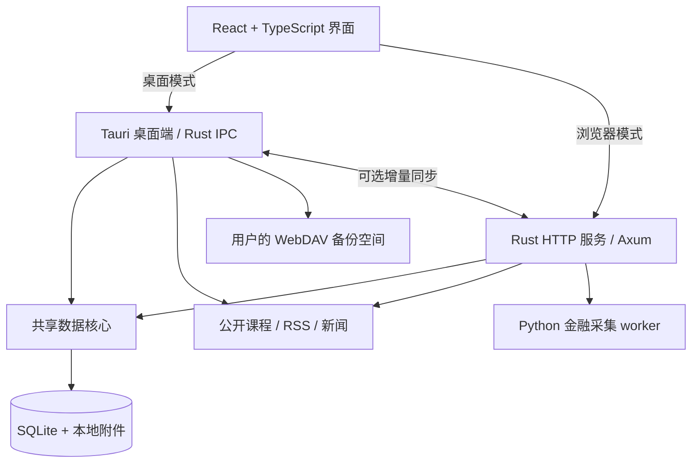

# Cetrinw · 知识与日常

**把笔记、研究资料与英语学习，放进一个本地优先的个人工作台。**

Cetrinw 是基于 Tauri、React 和 Rust 构建的桌面应用。你可以离线写笔记、整理研究线索，也可以订阅 RSS、下载公开英语课程，把阅读和学习中的收获留在自己的资料库中。

笔记和附件保存在本机，基础使用无需账号或服务器。需要跨设备同步、金融数据采集或 WebDAV 备份时，再配置相应服务。

> 当前版本：**0.1.0 · macOS 桌面预览版**。目前以 Apple Silicon Mac 为开发和验证平台，仍在持续迭代。Windows、Linux、Android、iPhone 和 iPad 尚未验证或交付。

[下载安装](#下载安装) · [快速开始](#快速开始) · [功能概览](#功能概览) · [开发与验证](#开发与验证) · [已知限制](#已知限制) · [自部署说明](docs/self-hosting.md)

## 下载安装

前往 [GitHub Releases · v0.1.0](https://github.com/cetrinw/cetrinw-notes/releases/tag/v0.1.0) 下载 **macOS Apple Silicon（M 系列芯片）** 预览版，要求 macOS 13 或更新版本。

- `Cetrinw_0.1.0_aarch64.dmg`：打开后将 Cetrinw 拖入“应用程序”。
- `Cetrinw_0.1.0_aarch64.app.zip`：解压后得到同一版本的 `.app`。
- `SHA256SUMS`：安装包校验值，下载后可运行 `shasum -a 256 -c SHA256SUMS` 核对同目录中的两个安装包。

安装包使用 ad-hoc 签名，尚未通过 Apple Developer ID 签名与公证。macOS 可能提示无法验证开发者；确认文件来自本仓库后，可使用系统“隐私与安全性”中的“仍要打开”。升级前建议在应用内导出完整备份。功能范围、已知问题和验证边界见 [发布说明](docs/releases/v0.1.0.md)。

## 可以用它做什么

- **写下并连接想法**：用富文本和 Markdown 快捷输入做笔记，通过标签、文件夹、引用和反向链接组织内容。
- **围绕问题做研究**：把专题、公司、产业关系、事件、假设和证据连起来，记录判断条件与后续复盘。
- **把订阅变成自己的资料**：阅读 RSS / Atom、抓取文章正文、标记收藏，再将资料转存为笔记并关联研究专题。
- **每天学一点英语**：下载公开课程，逐句播放、系统朗读、查词和收藏生词，用间隔重复安排复习。
- **保留数据的主动权**：导出 Markdown、富文本结构和原始附件，或制作完整备份；按需连接自己的同步服务器。

## 功能概览

| 模块 | 当前能力 |
| --- | --- |
| 笔记与编辑 | 富文本、任务列表、代码块、公式、折叠块、图片、合并单元格表格；标签与文件夹；中文全文搜索、引用与反向链接 |
| 文件与阅读 | 附件管理、PDF 分页阅读与划线引用、Markdown 导入、Markdown + 附件 + 富文本 JSON 的 ZIP 导出 |
| 研究工作台 | 专题、研究对象、关系与证据、事件、假设和验证条件；周期与阶段、事件时间轴、指标图表及研究模板 |
| 订阅与新闻 | RSS / Atom、OPML 导入导出、网页订阅发现、46 条推荐源目录、分类与检查间隔、收藏和已读、正文提取、阅读进度及朗读 |
| 英语学习 | VOA Level 1 52 课、ELLLO A1 25 课目录；音频和课文下载；自有音频及 SRT / LRC / TXT 导入；变速、逐句循环、时间轴校准、录音回放 |
| 查词与复习 | 本地 ECDICT 英汉词典 30,066 条；生词收藏、FSRS 间隔重复、学习记录；中英对照生成、编辑与保存 |
| 数据采集 | World Bank、AKShare、Tushare、FRED、SEC XBRL、RSS 和 HTTP JSON 适配器；采集任务状态与错误记录 |
| 数据管理 | SQLite WAL、版本历史、删除恢复、冲突副本、附件 SHA-256、每日快照、完整备份与合并恢复、个人服务器增量同步 |

### 离线和联网的边界

| 使用场景 | 依赖 |
| --- | --- |
| 写笔记、整理研究、中文搜索、读取本地词典 | 本机即可 |
| 播放已下载课程、阅读已保存文章、复习生词 | 本机即可；系统朗读依赖已安装的语音 |
| 首次下载课程、刷新 RSS / 新闻、抓取正文 | 访问相应公开网站 |
| 新生成中英翻译 | 当前使用 MyMemory 公共接口；已有译文和翻译缓存可离线读取 |
| 金融数据采集、跨设备增量同步 | 自部署 Cetrinw 服务器；部分来源另需 API 凭据 |
| WebDAV 完整备份 | 用户自己的 WebDAV 服务，例如坚果云 |

离线翻译目前已具备模型下载与缓存管线，**ONNX 推理尚未接通**。下载模型后仍不能离线生成新译文。

## 快速开始

### 环境要求

- Apple Silicon Mac，macOS 13 或更新版本。
- Node.js 22+ 与 npm。
- Rust stable，以及 macOS Command Line Tools。
- 首次安装依赖需要联网；Python 仅在使用金融采集 worker 时需要。

```sh
git clone https://github.com/cetrinw/cetrinw-notes.git
cd cetrinw-notes
npm ci
npm run tauri dev
```

尚未安装 Command Line Tools 时，先执行 `xcode-select --install`。若已安装 Rust 但终端找不到 `cargo`，执行：

```sh
export PATH="$HOME/.cargo/bin:$PATH"
```

桌面端直接通过 Rust IPC 访问本地 SQLite，无需另外启动 HTTP 服务。

### 浏览器开发预览

浏览器模式使用真实 Rust 服务与 SQLite。在两个终端分别运行：

```sh
# 终端一：启动后端，默认监听 127.0.0.1:4318
cargo run -p cetrinw-server
```

```sh
# 终端二：启动前端
npm run dev
```

打开 [http://127.0.0.1:1420](http://127.0.0.1:1420)。浏览器预览与桌面端使用独立资料库，默认不会互相同步。

### 构建桌面应用

```sh
npm run tauri build
```

输出位于 `target/release/bundle/`，包含 `.app` 与 `.dmg`。当前配置使用本机 ad-hoc 签名，尚未进行 Apple Developer ID 签名和公证。

金融采集、环境变量、服务器令牌与 WebDAV 配置见 [自部署说明](docs/self-hosting.md) 和 [.env.example](.env.example)。程序读取进程环境变量，不会自动加载 `.env`。

## 数据放在哪里

| 内容 | 默认位置 |
| --- | --- |
| macOS 桌面资料库 | `~/Library/Application Support/org.cetrinw.notes/` |
| 浏览器开发服务资料库 | `.data/server/`，可通过 `CETRINW_DATA_DIR` 修改 |
| 笔记和结构化记录 | 资料库目录中的 `notes.sqlite3` |
| 原始附件 | `assets/<SHA-256>` |
| 每日快照 | `backups/YYYY-MM-DD/`，保留最近 30 份成功快照 |

- 完整导出包含笔记、研究记录、课程、学习记录、附件和历史；服务地址与凭据不进入完整导出。
- macOS 的同步令牌和 WebDAV 密码存放在系统钥匙串。
- 迁移前先退出应用，再完整复制资料库；运行期间使用应用内导出或 SQLite backup。
- WebDAV 保存完整备份，Cetrinw 服务器处理增量同步。不要使用网盘直接同步运行中的 SQLite 文件。
- `.data/`、`.env`、`output/`、构建产物与本地开发缓存均在 Git 忽略范围内。仓库中的 `resources/dictionary.sqlite3` 是带来源与许可证的公共词典资源。

## 技术结构



| 路径 | 职责 |
| --- | --- |
| `src/` | React 页面、编辑器、图表、播放器与数据访问 |
| `src-tauri/` | 桌面端入口、IPC、原生能力与打包配置 |
| `crates/core/` | SQLite、全文索引、记录版本、附件、备份与同步协议 |
| `crates/server/` | HTTP API、采集适配器和调度 |
| `crates/learning/` | 课程下载、RSS / 新闻、正文提取和在线翻译 |
| `crates/cloud/` | WebDAV 备份传输 |
| `crates/translate/` | 翻译模型管理与待完成的离线推理接入 |
| `workers/` | Python 金融数据采集 |
| `resources/` | 公开词典、课程目录、数据预置和研究模板 |
| `scripts/` | 集成验证、现实夹具及数据资源构建工具 |
| `docs/` | 自部署、验证记录和迭代说明 |

## 开发与验证

```sh
# 前端行为测试与生产构建
npm test
npm run build

# Rust 工作区测试，包含桌面端编译
cargo test --workspace

# 隔离资料库中的 HTTP → Rust → SQLite 集成验证
cargo build -p cetrinw-server
python3 scripts/integration_check.py
```

测试脚本使用独立临时资料库，集成检查默认使用 `14318` 端口。需要验证外部金融接口时，先按自部署说明准备 Python worker 依赖，再执行：

```sh
python3 scripts/integration_check.py --live

# 真实公开课程、新闻、RSS 与在线翻译；会访问外部服务
python3 scripts/learning_check.py

# 10,000 篇非空研究夹具的 Rust 搜索性能检查
cargo run -p cetrinw-core --example note_benchmark
```

编译和测试结果只覆盖各自执行的路径。现实夹具、缓存或错误分支的结果，不代表真实外部服务或原生桌面操作已经验证。最近一次 [项目检查](docs/project-check-2026-10-15.md) 包含本地测试结果和待修复问题；历史实测范围见 [验证记录](docs/verification.md)，近期改动见 [第三轮迭代记录](docs/iteration-3.md)。

## 已知限制

- **预览版状态**：macOS 麦克风、媒体中断、中文输入法、异常退出恢复和长期运行仍需专项回归。
- **待修复问题**：RSS 再次刷新可能把已提取全文替换回摘要并清除对应译文；单次同步当前只发送最多 500 条待同步记录。复现条件和检查范围见 [项目检查](docs/project-check-2026-10-15.md)。
- **离线翻译**：模型管理已实现，推理与质量评估待完成；当前新译文依赖 MyMemory 的可用性与额度。
- **金融数据**：当前日线为未复权价格；拆股、分红、完整交易日历和指标历史修订尚未完整处理。来源存在不等于所有接口当前可用。
- **同步与规模**：面向个人使用，冲突保留副本；没有多人实时协作、端到端加密或附件按需同步。部分列表、查询和同步批次有数量上限，大资料库仍需优化。
- **云端备份**：WebDAV 单份完整备份上限 250 MB，不自动删除远端历史；Notion 和 Google Drive 专用 API 尚未接入。
- **公开资源**：目录数量不代表全部内容已逐项验证；课程、RSS 和新闻的可用性受原站更新、网络和版权条件影响。
- **学习能力**：没有 ASR 字幕和高级发音评分；播放与录音时长不等同于实际专注学习时长。

## 参与开发

欢迎通过仓库 Issues 描述问题或提交改进建议。报告问题时，请注明系统版本、桌面或浏览器模式、复现步骤与预期结果；日志和示例应移除个人笔记、服务令牌与其他凭据。

提交代码时请保持改动范围清晰，说明验证方式。涉及存储、同步或备份的改动，应使用非空现实数据覆盖保存、恢复与冲突路径。

## 来源与许可证

程序采用 [MIT License](LICENSE)。第三方依赖及内容保留各自许可证和版权。

- **ECDICT**：离线词典来自 [skywind3000/ECDICT](https://github.com/skywind3000/ECDICT)，MIT；仓库附 [许可证](resources/ECDICT-LICENSE.txt) 与 [来源、筛选和校验记录](resources/dictionary-source.json)。
- **VOA Learning English**：[官方课程目录](https://learningenglish.voanews.com/p/5644.html) / [使用条款](https://learningenglish.voanews.com/p/6021.html)。VOA 自制内容与第三方内容适用条件不同，请以原站条款为准。
- **ELLLO**：[A1 官方目录](https://elllo.org/book/A1/index.html) / [来源说明](https://elllo.org/about/index.htm)。内容版权归原作者，按官方公开链接下载供个人学习。
- **新闻与 RSS**：保留原始来源和链接，文章版权属于各自权利人。

仓库提供课程目录和下载连接器，不随源码打包第三方教材。新概念等教材需使用用户自有或获授权的材料。
